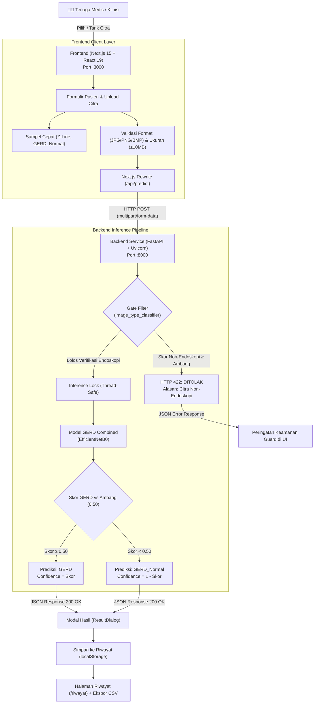

# PROJECT PROFILE
# GERD Classification — Sistem Klasifikasi Citra Endoskopi Berbasis Deep Learning

> **Versi Dokumen:** 2.0.0 · **Pembaruan:** November 2026  
> **Status:** Prototipe Penelitian / Aplikasi Web CDSS Siap Uji  
> **Disclaimer:** Seluruh hasil prediksi bersifat eksperimental dan **bukan merupakan diagnosis medis mandiri**. Selalu interpretasikan bersama dokter spesialis atau tenaga medis yang kompeten.

---

## Daftar Isi

1. [Ringkasan Eksekutif](#1-ringkasan-eksekutif)
2. [Latar Belakang Klinis](#2-latar-belakang-klinis)
3. [Arsitektur Sistem Terintegrasi](#3-arsitektur-sistem-terintegrasi)
4. [Dataset & Spesifikasi Model](#4-dataset--spesifikasi-model)
5. [Arsitektur Model Deep Learning](#5-arsitektur-model-deep-learning)
6. [Sistem Filter Citra (Image-Type Gate Guard)](#6-sistem-filter-citra-image-type-gate-guard)
7. [Backend API (FastAPI)](#7-backend-api-fastapi)
8. [Frontend Aplikasi Web (Next.js 15)](#8-frontend-aplikasi-web-nextjs-15)
9. [Fitur Unggulan Antarmuka & UX](#9-fitur-unggulan-antarmuka--ux)
10. [Struktur Proyek](#10-struktur-proyek)
11. [Stack Teknologi](#11-stack-teknologi)
12. [Keterbatasan & Arah Pengembangan](#12-keterbatasan--arah-pengembangan)
13. [Kesesuaian Klinis & Etika](#13-kesesuaian-klinis--etika)

---

## 1. Ringkasan Eksekutif

**GERD Classification** adalah sistem *Clinical Decision Support System* (CDSS) berbasis kecerdasan buatan (*Deep Learning*) yang dirancang untuk membantu dokter spesialis dan tenaga medis dalam menyaring (*screening*) serta mengklasifikasikan citra endoskopi saluran cerna atas (*Esophagogastroduodenoscopy* / EGD). Sistem ini mengklasifikasikan citra ke dalam dua kategori klinis utama:

| Kelas | Label Sistem | Deskripsi Klinis |
|---|---|---|
| **Esofagitis Erosif (GERD)** | `GERD` | Terdapat erosi, lesi, atau mucosal breaks pada esofagus distal (konsisten dengan Klasifikasi Los Angeles / LA Grade A–D). |
| **Normal / Non-Erosive** | `GERD_Normal` | Mukosa esofagus normal atau Non-Erosive Reflux Disease (NERD) tanpa defek mukosa yang terlihat secara makroskopis. |

### Pembaruan & Pilar Utama Sistem:
1. **Model Klasifikasi Terpadu (`model_gerd_combined.keras`)** — EfficientNetB0 hasil pelatihan gabungan (*combined training*) dengan normalisasi input internal dan komputasi inferensi teroptimasi.
2. **Gerbang Keamanan Citra (`image_type_classifier.keras`)** — Filter awal (*Image-Type Gate*) berbasis EfficientNetB0 yang mendeteksi dan menolak citra non-endoskopi (foto luar, rontgen, dokumen, dll.) sebelum diproses oleh model klasifikasi GERD. Citra yang tidak lolos ditolak dengan kode status HTTP 422.
3. **Frontend Modern (Next.js 15 App Router + React 19)** — Antarmuka web responsif dengan navigasi multi-halaman (`/`, `/analisis`, `/riwayat`, `/profil`), dropzone interaktif dengan sampel bawaan, dialog modal hasil (*ResultDialog*), penyimpanan riwayat lokal (*localStorage*), ekspor CSV, dan dukungan tema terang/gelap (*Dark Mode*).
4. **Integrasi Proxy Transparan** — Next.js Route Rewrites meneruskan panggilan `/api/*` langsung ke FastAPI backend (Port 8000), menghilangkan kendala *Cross-Origin Resource Sharing* (CORS) saat beroperasi.

---

## 2. Latar Belakang Klinis

### Gastroesophageal Reflux Disease (GERD)
GERD adalah gangguan pencernaan kronis di mana asam lambung dan cairan gastrik mengalir balik ke esofagus, memicu gejala seperti *heartburn* dan regurgitasi, serta berisiko menyebabkan komplikasi seperti striktur esofagus, ulkus, hingga esofagus Barrett.

### Relevansi AI dalam Endoskopi
- **Mengurangi Beban Kognitif:** Membantu dokter saat melakukan evaluasi citra dalam jumlah besar.
- **Konsistensi Penilaian:** Meminimalkan variasi interpretasi antar pemeriksa (*inter-observer variability*).
- **Alat Skrining Awal:** Memberikan indikasi pendukung sebelum laporan medis final disahkan oleh dokter spesialis gastroenterologi.

---

## 3. Arsitektur Sistem Terintegrasi



---

## 4. Dataset & Spesifikasi Model

### Dataset Pelatihan
- **Sumber:** Kumpulan citra endoskopi esofagus dari dataset referensi medis publik (termasuk HyperKvasir) dan data klinis teranotasi.
- **Data Gate Filter:** Dilatih dengan citra endoskopi positif serta citra medis non-endoskopi (NIH ChestX-ray, CIFAR-10, foto umum) untuk mengenali perbedaan tekstur dan pencahayaan mukosa endoskopi.
- **Format Citra:** JPEG, PNG, dan BMP.
- **Ukuran Input:** $224 \times 224$ piksel, 3 kanal warna (RGB).

---

## 5. Arsitektur Model Deep Learning

### Spesifikasi Model Utama (`model_gerd_combined.keras`)
- **Arsitektur Dasar:** EfficientNetB0 (Transfer Learning berbasis ImageNet)
- **Dimensi Input:** `(None, 224, 224, 3)`
- **Karakteristik Arsitektur:**
  - *Mobile Inverted Bottleneck Convolution* (MBConv) dengan modul *Squeeze-and-Excitation* (SE).
  - *Swish Activation* untuk efisiensi propagasi gradien.
  - Lapisan *GlobalAveragePooling2D* menuju *Dropout* dan *Dense*.
- **Lapisan Output:** 1 unit neuron `Dense` dengan fungsi aktivasi *Sigmoid* ($p \in [0, 1]$).
- **Interpretasi Output:**
  - Nilai keluaran merepresentasikan probabilitas citra mengalami esofagitis erosif ($P(\text{GERD})$).
  - $P(\text{Normal}) = 1.0 - P(\text{GERD})$.
- **Batas Keputusan (Threshold):** `0.50`
  - Jika $P(\text{GERD}) \ge 0.50 \rightarrow$ label `GERD`.
  - Jika $P(\text{GERD}) < 0.50 \rightarrow$ label `GERD_Normal`.

---

## 6. Sistem Filter Citra (Image-Type Gate Guard)

Untuk mencegah model memproses citra yang salah (misalnya foto pemandangan, dokumen resep, citra CT-Scan, atau X-Ray dada), sistem menerapkan filter gerbang keamanan sebelum inferensi utama dijalankan.

### Alur Kerja Gate Filter (`guard.py`)
1. **Validasi File:** Memastikan integritas berkas citra, format pendukung (`JPEG`, `PNG`, `BMP`), serta resolusi minimal ($\ge 32 \times 32$ piksel) dan maksimal ($< 50 \text{ MP}$).
2. **Inferensi Gate (`image_type_classifier.keras`):**
   - Citra di-*resize* ke $224 \times 224$ piksel.
   - Model gate menghitung `skor_non_endoscopy` ($0.0 - 1.0$).
3. **Penyaringan Berdasarkan Ambang Batas:**
   - Ambang batas filter diatur pada konfigurasi `image_type_config.json` (`non_endoscopy_threshold = 0.01`).
   - Apabila skor $\ge$ ambang batas, citra dikategorikan `DITOLAK`.
   - Backend merespons dengan **HTTP 422 Unprocessable Entity**, memuat alasan penolakan secara spesifik.

---

## 7. Backend API (FastAPI)

Backend dibangun menggunakan **FastAPI** dan disajikan melalui **Uvicorn ASGI Server**.

### Ringkasan Endpoint

#### 1. `GET /`
Endpoint dasar untuk verifikasi status API.
```json
{
  "message": "GERD Classification API aktif",
  "version": "4.0.0",
  "docs": "/docs",
  "health": "/health"
}
```

#### 2. `GET /health`
Pemeriksaan kesiapan model klasifikasi dan model filter citra.
```json
{
  "status": "ok",
  "model_loaded": true,
  "image_type_gate_loaded": true,
  "embedding_ood_loaded": false,
  "model_path": "model/combined/model_gerd_combined.keras",
  "gate_model_path": "model/gate/image_type_classifier.keras",
  "threshold": 0.50
}
```

#### 3. `POST /predict`
Endpoint utama inferensi citra.
- **Content-Type:** `multipart/form-data`
- **Body:** `file` (File gambar biner: JPG, PNG, atau BMP, maks. 10 MB)

**Contoh Respons Sukses (200 OK):**
```json
{
  "prediction": "GERD",
  "status": "GERD",
  "confidence": 0.941258,
  "probabilities": {
    "GERD_Normal": 0.058742,
    "GERD": 0.941258
  },
  "skor_gerd": 0.941258,
  "threshold": 0.50,
  "guard": true,
  "gate": {
    "status": "LOLOS_GATE",
    "skor_non_endoscopy": 0.000124,
    "ambang_non_endoscopy": 0.01
  },
  "reason": "Lolos filter tipe gambar. OOD embedding khusus model combined belum dikalibrasi.",
  "model": "EfficientNetB0_GERD_Combined",
  "disclaimer": "Hasil eksperimental, bukan diagnosis medis. Perlu interpretasi tenaga kesehatan.",
  "filename": "endoskopi_pasien.jpg"
}
```

**Contoh Respons Ditolak Guard (422 Unprocessable Entity):**
```json
{
  "detail": "Gambar terdeteksi sebagai non-endoskopi oleh image-type gate."
}
```

---

## 8. Frontend Aplikasi Web (Next.js 15)

Frontend dibangun dengan arsitektur **Next.js 15 App Router** berbasis **React 19** dan **TypeScript**.

### Peta Rute Navigasi (`app/`)
- **`/` (Beranda):** Halaman awal yang memuat perkenalan sistem, ringkasan alur kerja tiga langkah, fakta model, serta tombol aksi cepat untuk memulai analisis.
- **`/analisis` (Modul Analisis):** Halaman utama pengunggahan citra endoskopi, pemilihan sampel cepat, pengisian data anonim pasien (ID anonim, usia, jenis kelamin, keluhan klinis), dan pemanggilan inferensi backend.
- **`/riwayat` (Arsip Pemeriksaan):** Tabel riwayat hasil analisis dengan thumbnail visual, filter kategori (*Semua*, *GERD*, *Normal*), pencarian ID pasien, penomoran halaman (*pagination*), cetak hasil, dan tombol **Ekspor CSV**.
- **`/profil` (Profil Pengguna):** Pengaturan data akun dokter/tenaga medis dan pengaturan **Ambang Batas Keyakinan (*Threshold*)** kustom ($50\% - 98\%$) dengan opsi preset sensitivitas tinggi vs spesifisitas tinggi.
- **`/login`, `/register`, `/forgot-password`:** Halaman antarmuka autentikasi pengguna.

---

## 9. Fitur Unggulan Antarmuka & UX

1. **Area Unggah & Dropzone Interaktif:**
   - Mendukung klik langsung, *drag-and-drop*, serta navigasi papan ketik (*Enter* / *Space*).
   - Validasi sisi klien secara instan untuk tipe berkas (`JPG`, `PNG`, `BMP`) dan ukuran berkas ($\le 10\text{ MB}$).
   - Pratinjau (*preview*) citra seketika dengan informasi ukuran berkas dan tombol *Ganti Citra* serta *Hapus*.
2. **Sampel Uji Cepat Bawaan:**
   - Tersedia tombol cepat untuk memuat sampel endoskopi (*Sampel Z-Line*, *Sampel GERD*, *Sampel Normal*) tanpa perlu mengunggah file dari perangkat lokal.
3. **Peringatan Guard Terpadu:**
   - Jika citra ditolak oleh backend (status 422), kartu peringatan merah informatif ditampilkan dengan pesan penolakan yang ramah pengguna.
4. **Dialog Hasil Prediksi (*ResultDialog*):**
   - Menampilkan label hasil (`GERD` atau `Normal`), bilah persentase keyakinan model, rincian probabilitas tiap kelas, status kepatuhan ambang batas profil pengguna, opsi cetak langsung (*print view*), serta penyimpanan ke riwayat.
5. **Dukungan Dark Mode Dinamis:**
   - Menggunakan variabel CSS modern dengan tema terang dan gelap otomatis yang dapat diubah secara manual melalui tombol toggle di bilah navigasi atas.

---

## 10. Struktur Proyek

```
GERD Classification/
│
├── README.md                          # Panduan operasional cepat
├── PROJECT_PROFILE.md                 # ← Dokumen profil proyek (ini)
│
├── backend/                           # Layanan Backend FastAPI
│   ├── main.py                        # Endpoint API (/predict, /health, /) & lifespan loader
│   ├── guard.py                       # Filter citra GERDGuard (image-type verification)
│   ├── requirements.txt               # Dependensi Python backend
│   │
│   └── model/
│       ├── combined/
│       │   └── model_gerd_combined.keras      # Model klasifikasi aktif EfficientNetB0
│       └── gate/
│           ├── image_type_classifier.keras    # Model filter citra endoskopi
│           └── image_type_config.json         # Konfigurasi ambang gate (0.01)
│
└── frontend/                          # Aplikasi Web Next.js 15
    ├── next.config.mjs                # Konfigurasi rewrite proxy /api/* -> :8000
    ├── package.json                   # Dependensi Next.js & React 19
    ├── tsconfig.json                  # Konfigurasi TypeScript
    │
    ├── app/
    │   ├── layout.tsx                 # Root layout dengan SiteHeader & SiteFooter
    │   ├── globals.css                # Sistem tema CSS variables (Light/Dark mode)
    │   ├── page.tsx                   # Halaman beranda
    │   ├── analisis/
    │   │   └── page.tsx               # Modul input citra, formulir & analisis
    │   ├── riwayat/
    │   │   └── page.tsx               # Halaman riwayat, filter, pencarian & ekspor CSV
    │   ├── profil/
    │   │   └── page.tsx               # Halaman profil & konfigurasi ambang batas
    │   ├── login/page.tsx             # Halaman login
    │   ├── register/page.tsx          # Halaman registrasi
    │   └── forgot-password/page.tsx   # Halaman reset sandi
    │
    ├── components/
    │   ├── SiteHeader.tsx             # Bilah navigasi utama
    │   ├── SiteFooter.tsx             # Catatan kaki & disclaimer medis
    │   ├── ThemeToggle.tsx            # Pengalih mode terang / gelap
    │   └── ResultDialog.tsx           # Modal hasil prediksi klasifikasi
    │
    ├── lib/
    │   ├── api.ts                     # Klien API fetch (/api/predict) & normalisasi data
    │   ├── store.ts                   # Manajemen state riwayat & profil di browser (localStorage)
    │   └── auth.ts                    # Helper simulasi autentikasi
    │
    └── public/
        ├── icon.png                   # Ikon favicon aplikasi
        └── img/
            ├── sampel-zline.jpg       # Citra sampel esofagus Z-Line
            ├── thumb-gerd.jpg         # Citra sampel kasus GERD
            └── thumb-normal.jpg       # Citra sampel kasus Normal
```

---

## 11. Stack Teknologi

### Backend
| Komponen | Pilihan Teknologi | Deskripsi / Peran |
|---|---|---|
| **Bahasa Pemrograman** | Python 3.11 | Bahasa utama backend komputasi |
| **Framework API** | FastAPI | Framework REST API asinkron berkinerja tinggi |
| **Server ASGI** | Uvicorn | Server HTTP/ASGI untuk menjalankan FastAPI |
| **Machine Learning** | TensorFlow / Keras 2.21 | Pemuatan model `.keras` dan eksekusi inferensi |
| **Pemrosesan Citra** | Pillow (PIL) | Validasi biner gambar, sanitasi, dan konversi RGB |
| **Komputasi Matriks** | NumPy | Manipulasi array numerik dan normalisasi |
| **Pengunggahan Berkas** | python-multipart | Parser data form `multipart/form-data` |

### Frontend
| Komponen | Pilihan Teknologi | Deskripsi / Peran |
|---|---|---|
| **Framework Aplikasi** | Next.js 15 (App Router) | Framework React modern untuk *production-ready web* |
| **UI Library** | React 19 | Library komponen antarmuka pengguna deklaratif |
| **Bahasa** | TypeScript 5.6 | Sistem *type-safety* untuk meminimalkan *runtime error* |
| **Styling & Tema** | CSS Variables Modern | Desain terpusat di `globals.css` dengan dukungan tema gelap/terang |
| **Penyimpanan Lokal** | Browser LocalStorage | Penyimpanan persisten untuk arsip riwayat dan profil dokter |
| **Pencegahan CORS** | Next.js Rewrites Proxy | Menjembatani panggilan `/api/*` langsung ke server backend |

---

## 12. Keterbatasan & Arah Pengembangan

### Keterbatasan Saat Ini
1. **Klasifikasi Biner:** Model saat ini membedakan antara `GERD` dan `GERD_Normal`. Belum membagi ke dalam tingkatan detail Klasifikasi Los Angeles (Grade A, B, C, D).
2. **Penyimpanan Riwayat Sisi Klien:** Riwayat analisis saat ini disimpan di *localStorage* peramban pengguna. Belum terhubung ke basis data server terpusat (PostgreSQL/MySQL).
3. **Autentikasi Pengguna:** Formulir login dan registrasi saat ini masih bersifat simulasi antarmuka.

### Rencana Pengembangan Lanjutan
1. **Model Multi-Kelas Los Angeles:** Mengembangkan dataset anotasi tambahan untuk mengklasifikasikan keparahan GERD (Grade A/B/C/D).
2. **Integrasi Heatmap Grad-CAM pada Model Combined:** Menambahkan kembali lapisan visualisasi lokasi lesi mukosa untuk meningkatkan transparansi diagnosis.
3. **Penyimpanan Cloud & EMR Integration:** Menyambungkan sistem ke basis data rekam medis elektronik rumah sakit (*Electronic Medical Record* / EMR) melalui standar HL7 / FHIR.

---

## 13. Kesesuaian Klinis & Etika

### Posisi Regulasi & Kepatuhan
Sistem ini berstatus sebagai **perangkat lunak bantu penelitian (*Research Decision Support Tool*)** dan belum diajukan sebagai *Software as a Medical Device* (SaMD) bersertifikasi BPOM maupun regulasi internasional.

### Pernyataan Etika & Keamanan
1. **Human-in-the-Loop:** Kecerdasan buatan hanya berperan sebagai pemberi opini kedua (*second opinion*). Keputusan akhir diagnostik dan rencana intervensi medis sepenuhnya berada di bawah kewenangan dokter spesialis.
2. **Perlindungan Privasi Pasien:** Formulir analisis menggunakan **ID Pasien Anonim** untuk memastikan tidak ada data identitas pribadi (*Personally Identifiable Information* / PII) pasien yang tersimpan secara terbuka.
3. **Keandalan Masukan:** Sistem menolak berkas non-endoskopi secara otomatis guna mencegah kesimpulan yang menyesatkan (*misleading prediction*).

---

*Dokumen ini diperbarui secara komprehensif mengikuti implementasi model EfficientNetB0 gabungan terbaru, sistem filter gerbang citra, dan arsitektur Next.js 15.*
